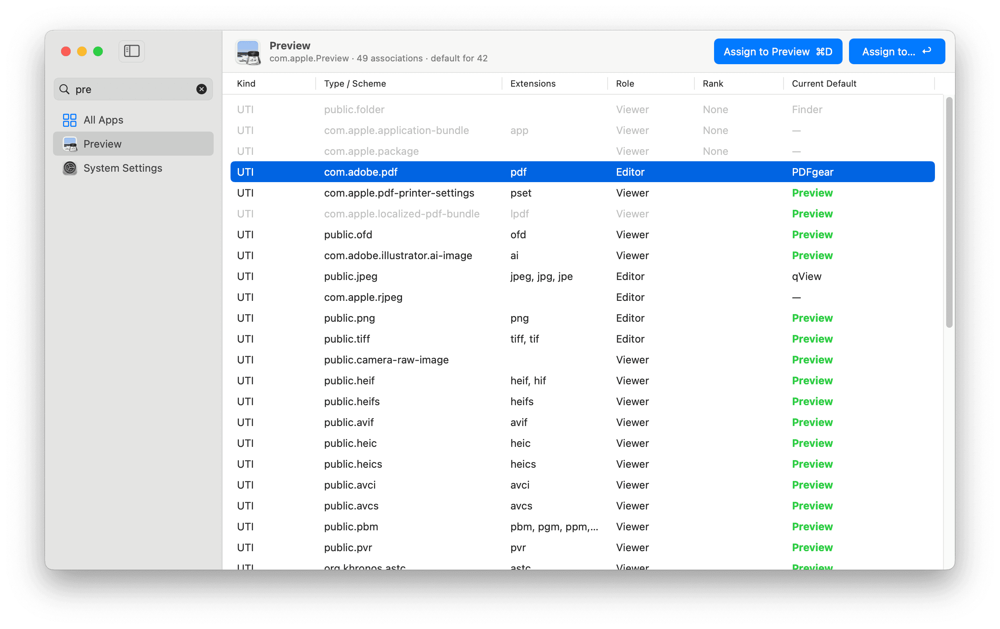
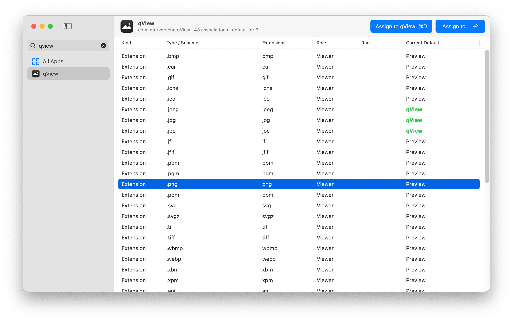
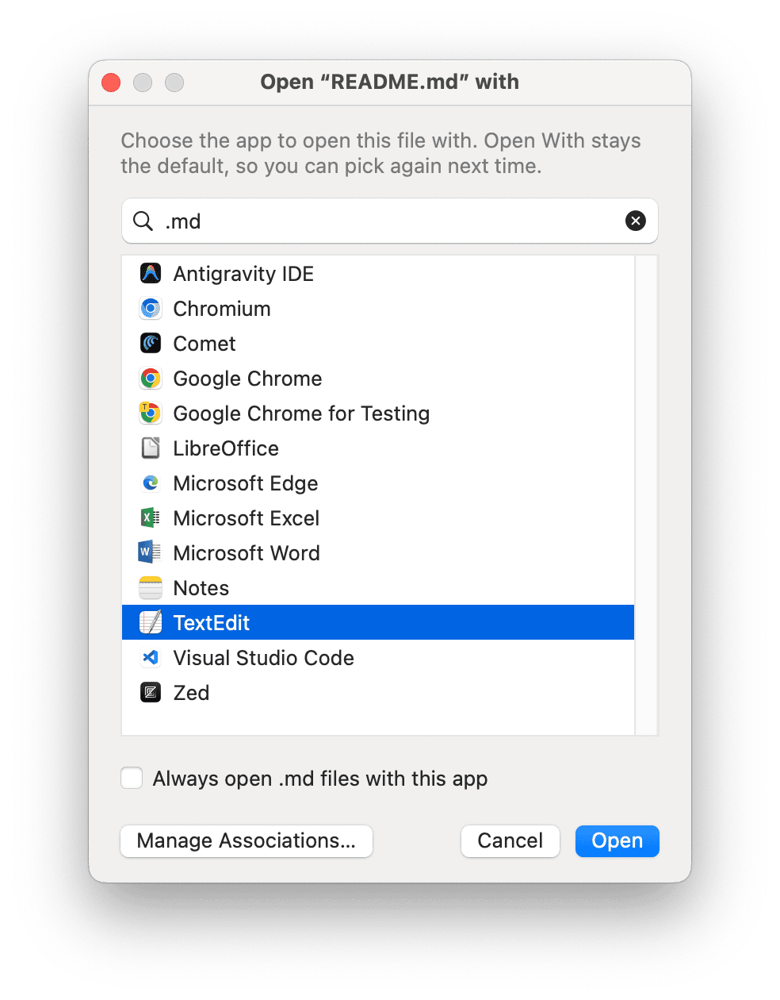

<p align="center">
  
</p>

# Open With: choose which app opens your files on a Mac

**Open With** is a free, small Mac app that shows which app opens each kind of file, such as PDFs, pictures, text, and web pages, and lets you change it in a couple of clicks. It also handles links: pick your default web browser, mail app, and so on.

PDFs keep opening in the wrong app? Make Preview the default:



Prefer another image viewer? Send PNG pictures to qView:



## Why

The Mac has no single place that shows which app opens what. In Finder you can use *Get Info → Open with → Change All…*, but only for one file type at a time, it doesn't cover links, and sometimes the change doesn't stick. Open With puts everything in one window, lets you search it, and changes many file types at once.

## What it does

- **See everything in one list.** Every file type on your Mac and the app that currently opens it.
- **See what an app can open.** Click an app in the sidebar to see all the file types it supports and which ones it already opens by default.
- **Search.** Type an app name (`Preview`) or a file type (`.pdf`) to find it fast.
- **Change many at once.** Select several file types and send them all to one app. Handy when you switch from one text editor to another.
- **Pick your browser and mail app.** Search `http` or `mailto` and choose the app.
- **Ask every time.** Make Open With the default for a file type, and you get a quick app chooser each time you open such a file. It remembers your last pick, and you can tick *Always open with this app* to stop being asked.
- **Safe by design.** File types your Mac needs to work properly, such as apps and folders, are greyed out and can't be changed by accident.

It can also ask you every time. Make Open With the default for a file type, and whenever you open such a file it shows a short list of apps to choose from.

<p align="center"></p>

## Install

Works on **macOS 12 Monterey or later**, on both Apple Silicon and Intel Macs.

1. Download the latest `OpenWith.dmg` from [Releases](https://github.com/hza/openwith/releases).
2. Open it and drag **Open With.app** into your **Applications** folder.
3. The first time you open it, macOS will say it can't check the app for malicious software, because the app isn't registered with Apple. Open **System Settings → Privacy & Security**, scroll down, and click **Open Anyway**.

   If you'd rather use Terminal, paste this command and press Return:

   ```sh
   xattr -dr com.apple.quarantine "/Applications/Open With.app"
   ```

## FAQ

### How do I change the default app for a file type on a Mac?

1. Open **Open With**.
2. Press **⌘F** and type the file type, for example `.pdf`.
3. Select the row and press **Return**.
4. Choose the app and click **Assign**.

### How do I move all file types from one app to another on a Mac?

For example, when you switch from one code editor to another:

1. Click the old app in the sidebar.
2. Click any row, then press **⌘A** to select all of them.
3. Press **Return**, choose the new app, and click **Assign**.

Or click the new app in the sidebar, press **⌘A**, then **⌘D** to make it the default for everything it can open.

### How do I change the default web browser or mail app on a Mac?

Search for `http` (or `mailto` for mail), select the rows, press **Return**, choose the app, and click **Assign**. macOS may ask you to confirm.

### How do I choose which app opens a file each time I open it?

Assign a file type, for example `.md`, to **Open With** itself. From then on, opening such a file shows a list of apps to choose from. Tick *Always open .md files with this app* if you want to stop being asked.

### Why do PDFs keep opening in the wrong app even after "Change All…" in Finder?

This is a common Mac problem. Search for `.pdf` in Open With, select the row, press Return, choose your PDF app (Preview, Acrobat, PDF Expert, …), and click Assign. It usually works when Finder's setting won't stick, and the same steps fix any other file type that keeps switching back.

### Does Open With run in the background or need special permissions?

No. It only runs while it's open and doesn't need any special access.

### Is Open With free?

Yes, free and open source.

## Keyboard shortcuts

| Shortcut | What it does |
|---|---|
| ⌘F | Search |
| Return | Send the selected file types to another app |
| ⌘D | Make the selected app the default for the selected file types |
| ⌘A | Select all |
| ⌘G | Show or hide apps that claim to open any file |
| ⌘R | Look for newly installed apps |

## License

[MIT](LICENSE) © 2026 Henady Zakalusky
