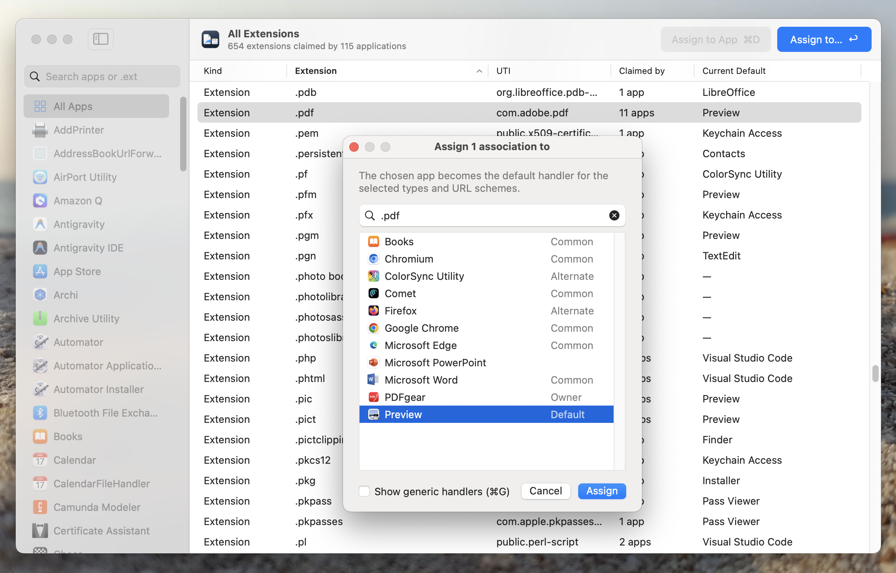
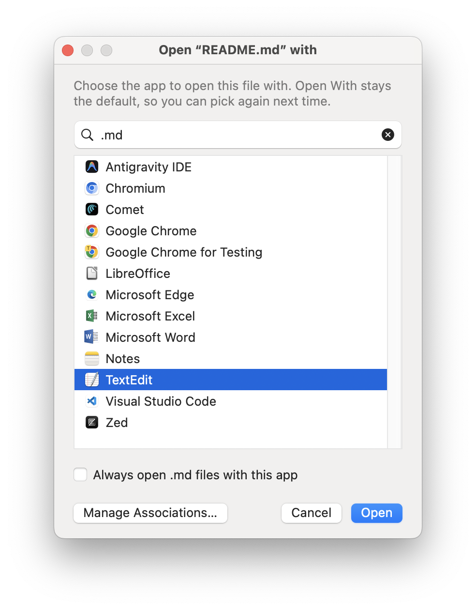

# Open With — change default apps for file types and URL schemes on macOS

**Open With** is a free, lightweight, native macOS app for viewing and changing **default application associations**: which app opens `.pdf`, `.md`, `.json`, `.html` and every other file extension, UTI (Uniform Type Identifier), and URL scheme (`http`, `mailto`, …) on your Mac. It can also act as an **"Open With" chooser**: set it as the default for a file type, and it asks which app to use every time you open a file of that type.

Written in plain Objective-C and AppKit. No Electron, no dependencies, no background daemons. Requires **macOS 12 Monterey or later** and runs natively on Apple Silicon and Intel.



## Why

macOS has no built-in screen that shows all file associations. The Finder's *Get Info → Open with → Change All…* works on one extension at a time and does not cover URL schemes. Command-line tools such as `duti` need you to know bundle IDs and UTIs. Open With lists everything in one window, lets you search it, and changes defaults in bulk with a couple of clicks.

## Features

- **Every association in one table.** Each extension claimed by any installed app, with its UTI, the number of apps that claim it, and the current default app.
- **Per-app view.** Select an app in the sidebar to see every document type, extension, UTI, and URL scheme it declares, its role (Editor/Viewer) and handler rank (Owner/Default/Alternate), and whether it is currently the default.
- **Search by app name or extension.** Type `.pdf` to find every app that can open PDFs, including apps that claim a parent UTI such as `public.image`.
- **Bulk reassignment.** Select many rows and press **Return** to assign them all to one app, or **⌘D** to make the selected app the default for its own types.
- **Change URL scheme handlers.** Set the default browser, mail client, or any custom `scheme://` handler.
- **"Open With" picker for files.** Make Open With the default for a file type and you get a quick, filterable chooser every time you open such a file. It remembers your last choice per extension and includes an *Always open with this app* checkbox.
- **Generic handlers hidden by default.** Apps that claim "any file" (`public.data`) are filtered out unless you press **⌘G**.
- **Copy to clipboard.** Use **⌘C** on any selection.



## Install

Build from source (needs the Xcode Command Line Tools: `xcode-select --install`):

```sh
git clone https://github.com/hza/openwith.git
cd openwith
make install     # builds and copies "Open With.app" to ~/Applications
```

`make install` also registers the app with LaunchServices, so it appears straight away in Finder's *Open With* menu.

The app is ad-hoc signed. If Gatekeeper complains on first launch, right-click the app and choose **Open**.

## Usage

1. Launch **Open With**. With **All Apps** selected, the table shows every known extension and its current default app.
2. Search with **⌘F**, by app name (`Preview`) or by extension (`.md`).
3. Select one or more rows and press **Return** (*Assign to…*), choose an app, and click **Assign**.
4. Or pick an app in the sidebar, select its rows, and press **⌘D** to make it the default for them.

### Use it as an "Open With" chooser

Assign a file type (for example `.md`) to **Open With** itself. Opening a Markdown file then shows the chooser, so you can pick the editor or viewer you want each time. Tick *Always open .md files with this app* to make that choice permanent. **Manage Associations…** opens the main window.

### Keyboard shortcuts

| Shortcut | Action |
|---|---|
| ⌘F | Search apps or extensions |
| Return | Assign selected rows to another app |
| ⌘D | Make the selected app the default for the selected rows |
| ⌘G | Show or hide generic handlers in the app picker |
| ⌘C | Copy the selected rows |
| ⌘R | Rescan installed applications |

## How it works

Open With scans `/Applications`, `/System/Applications`, `/System/Library/CoreServices` and `~/Applications`, and reads each app's `Info.plist` (`CFBundleDocumentTypes`, `LSItemContentTypes`, `CFBundleTypeExtensions`, `CFBundleURLTypes`). It resolves types with `UniformTypeIdentifiers` and reads and writes defaults through the public `NSWorkspace` APIs (`URLForApplicationToOpenContentType:`, `setDefaultApplicationAtURL:toOpenContentType:` and related calls). It uses no private APIs and does not edit the LaunchServices database by hand.

## Building

| Command | Description |
|---|---|
| `make` | Build and ad-hoc sign `build/Open With.app` |
| `make run` | Build and launch from `build/` |
| `make install` | Install to `~/Applications` and register with LaunchServices |
| `make open` | Quit, reinstall, and relaunch |
| `make uninstall` | Remove the app and its preferences |
| `make clean` | Remove `build/` |
| `make help` | List all targets |

## FAQ

**How do I change the default app for a file type on a Mac?**
Open Open With, search for the extension (for example `.pdf`), select the row, press Return, choose the app, and click Assign.

**How do I change the default app for every extension an app supports?**
Select the app in the sidebar, select all its rows (⌘A), and press ⌘D.

**How do I change the default browser or mail app?**
Select the browser or mail app in the sidebar, select its `http`/`https` or `mailto` URL scheme rows, and press ⌘D. macOS may ask you to confirm the change.

**Is it a replacement for `duti` or RCDefaultApp?**
Yes, it does the same job with a graphical interface: listing and changing file-extension, UTI, and URL-scheme handlers.

**Does it need special permissions or run in the background?**
No. It only uses public `NSWorkspace` APIs and runs only while it is open.

## License

[MIT](LICENSE) © 2026 Henady Zakalusky
